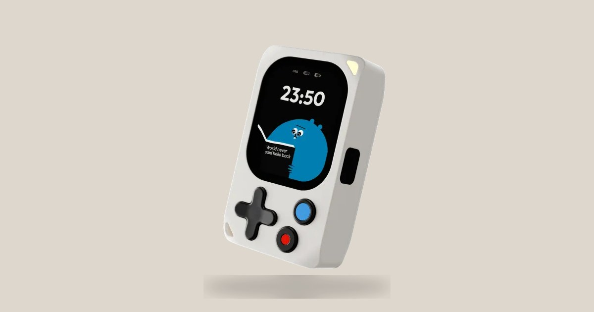

# Kode

**The Kode Dot: a pocket-size computer for makers, open from the bootloader up**

[Shop](https://kode.diy) ·
[Documentation](https://docs.kode.diy) ·
[Apps](https://apps.kode.diy) ·
[X](https://x.com/kodediy)

---

The Kode Dot is a programmable device that fits in your hand. Its main chip is an ESP32-P4. It has an AMOLED touch screen, six buttons, a battery, a speaker and a microphone, motion sensors, NFC, 125 kHz RFID, infrared and a header for modules. A second chip, an ESP32-C5, gives it Wi-Fi and Bluetooth.

The software that runs on it is here: the operating system, the SDK that every app is built with, the firmware of the radio and the catalog of apps.

## Start here

| You want to | Go to |
|---|---|
| set up your Kode Dot and use it | [docs.kode.diy](https://docs.kode.diy) |
| write your first app in C | [kode-app-template](https://github.com/kodediy/kode-app-template), then [kode-sdk](https://github.com/kodediy/kode-sdk) |
| publish your app for every Kode Dot | [apps.kode.diy](https://apps.kode.diy): upload its `.bin`, and Kode tries it on a Kode Dot before it is listed ([Marketplace](https://docs.kode.diy/ecosystem/marketplace)) |
| write a sketch with Arduino | [`arduino_hello`](https://github.com/kodediy/kode-sdk/tree/main/examples/arduino_hello) in kode-sdk, and [arduino-esp32](https://github.com/kodediy/arduino-esp32) |
| read or change the operating system | [KodeOS](https://github.com/kodediy/KodeOS) |

## The repositories

| Repository | What it holds |
|---|---|
| [kode-sdk](https://github.com/kodediy/kode-sdk) | The SDK: one driver for each chip, one Active Object for each part of the board, and `kode.h`, the calls an app makes |
| [KodeOS](https://github.com/kodediy/KodeOS) | kodeOS, the operating system: the screens, the console and the installer of apps |
| [kode_slave_c5](https://github.com/kodediy/kode_slave_c5) | The firmware of the ESP32-C5, the radio of the Kode Dot |
| [kode-app-template](https://github.com/kodediy/kode-app-template) | An empty app, the starting point for yours |
| [kode-apps](https://github.com/kodediy/kode-apps) | Kode's own apps, which Kode publishes on apps.kode.diy |

## Take part

- **A bug or an idea:** open an issue in the repository it belongs to.
- **A change:** open a pull request. [CONTRIBUTING.md](https://github.com/kodediy/.github/blob/main/CONTRIBUTING.md) says how.
- **A security problem:** do not open an issue. [SECURITY.md](https://github.com/kodediy/.github/blob/main/SECURITY.md) says where to write.

## Licence

kodeOS and the SDK are free software under the GNU General Public License, version 3 or later. The firmware of the radio is under the Apache License, version 2.0, and the drawings and animations of Kody under Creative Commons Attribution-ShareAlike 4.0. Each repository's `LICENSE` and `NOTICE.md` say which licence applies to each part.

Kode, Kode Dot, kodeOS and Kody are trademarks of Kode: [TRADEMARKS.md](https://github.com/kodediy/.github/blob/main/TRADEMARKS.md) says how you can use them. Everyone who takes part follows the [code of conduct](https://github.com/kodediy/.github/blob/main/CODE_OF_CONDUCT.md).
